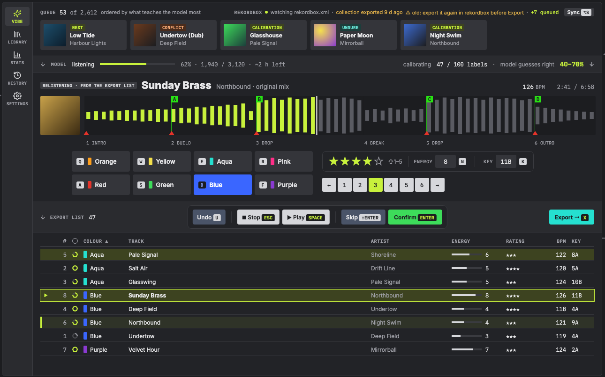

# Vibe Check

Learns how *you* label music, from the audio, and applies it to the rest of
your collection: colour, rating, key, energy and cue points, written into
rekordbox.



A native version for macOS, Windows and Linux, without the Python
dependency setup, is in the works.

The Python prototype it grew from is archived in `prototype.zip`, no longer
maintained; its README inside explains how it was used.

## The native version, so far

`core/` is the engine in Rust, with the commands the prototype had
(`scan`, `status`, `label`, `sync`, `discard`, `analyse`, `cues`, `migrate`),
reading and writing the same `.vibecheck/` files. `ext/` exposes it to Godot, and `app/` is the Godot app.

```sh
cargo build --release
./target/release/vibecheck status
./target/release/vibecheck label 100
```

It needs the audio model as an ONNX file (145 MB, weights in half
precision), made once from the prototype by
`scripts/export_clap_onnx.py` (in `prototype.zip`), at
`~/Library/Application Support/vibecheck/models/clap_audio.onnx` on macOS.
`scripts/bundle.sh` puts the program and the model in one folder to share or
back up.
No Python, ffmpeg or torch at runtime. Not yet ported: learning cue
placement from your own cues (it uses the model shipped with it).

### Running the app

You need [Rust](https://rustup.rs), [Godot 4.5+](https://godotengine.org/download)
(the standard build, not .NET) and the audio model above. The model is looked
for in `$VIBECHECK_MODELS`, then in the per-user folder:

| OS | Model folder |
|---|---|
| macOS | `~/Library/Application Support/vibecheck/models/` |
| Windows | `%APPDATA%\vibecheck\models\` |
| Linux | `~/.local/share/vibecheck/models/` |

1. Build the Godot extension. The first build downloads ONNX Runtime, so it
   needs internet.

   ```sh
   cargo build -p vibecheck_ext
   ```

   Running from the Godot editor loads `target/debug`. Its dependencies are
   built optimised, so this build is fast enough to use. Rebuild after every
   change to `core/` or `ext/`.
2. Open `app/project.godot` in Godot and press Play, or run it straight away:

   ```sh
   godot --path app
   ```

   On macOS, `godot` is `/Applications/Godot.app/Contents/MacOS/Godot`.

3. In rekordbox, choose File → Export Collection in xml format. On first
   start, the app opens Settings: pick your music folder and that
   `rekordbox.xml`. The other screens unlock once both are set.

To try another collection without changing your saved settings, add
`-- --music=<folder> --xml=<file>`.

MIT licensed.
