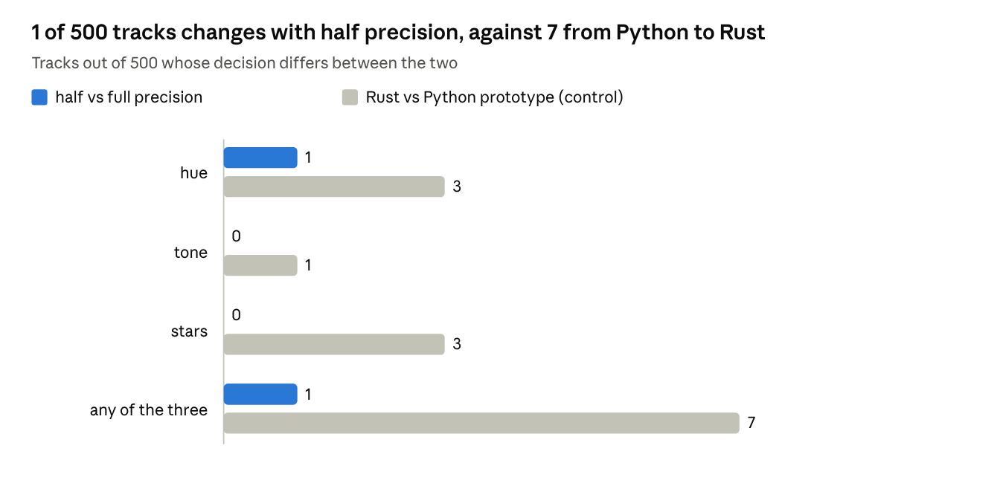
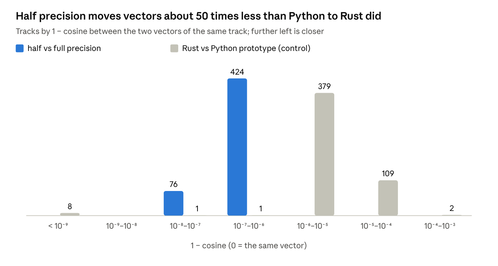
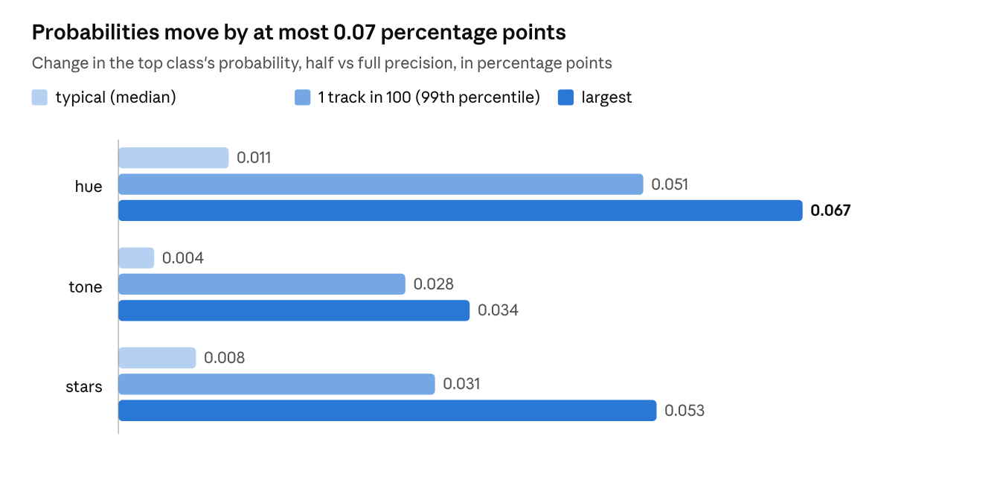

# Half-precision model: 500-track check

*2026-11-05.* Can the audio model's weights be stored in half precision
(145 MB instead of 284 MB) without changing any decisions?

## Verdict

**Yes, and it is now the default.** On 500 tracks the half-precision model
gave the same colour and the same rating as the full model on 499. On the one
other track, two hues were tied: Acidic and Vibrant both came out at 0.454,
0.00003 apart. The full model picked Acidic and the half-precision model picked
Vibrant, which is also what the Python prototype picked.

The control is the full model in Rust against the Python prototype's saved
vectors, on the same 500 tracks. Those two differ on 7 tracks, all of them on a
knife edge, where a probability shifting by less than 0.005 flips the
decision. Halving the model's size changes less than moving from Python to Rust
did.

The model drops from 284 MB to 145 MB, and the bundle from 308 MB to 169 MB.
Speed is the same: 5.06 against 5.03 s per track.

## Colour and rating

Each track goes through the same classifier three times: with the full model's
vector, the half-precision model's vector, and the vector the Python prototype
saved. Colour is hue plus tone, and rating is stars. A decision includes "not
sure", so a track counts as changed if one version names a colour or rating and
the other holds back.

## How close the vectors are

1 − cosine of each pair of 1024-number vectors, binned by power of ten. The
typical half-precision vector is 1.3 × 10⁻⁷ away from the full one, and the
furthest 4.4 × 10⁻⁷. Rust's full model against the vectors Python saved:
typically 7.2 × 10⁻⁶, at worst 4.6 × 10⁻⁴. The 8 control tracks at the far
left match to the last digit. The half-precision change is tight and uniform,
with no outliers: it never comes near the spread the Rust port already has.

## How close the probabilities are

|p(half) − p(full)| for the class the full model ranks first, the one changed
hue left out. The classifier turns each vector into a probability per class,
and a decision changes only when a probability crosses the threshold for that
axis or overtakes another class. The largest move on any track and axis is
0.067 points. A decision can only flip when it was already within that distance
of the line, which is what happened to the one hue that changed.

## Key, energy and cue points

The half-precision model can't change these three: none of them uses it. The
audio model is used for colour and rating only, so those are the decisions this
check measures.

| feature | computed from | uses the audio model |
|---|---|---|
| colour (hue and tone) | the audio model's vector, then the trained classifier | yes |
| star rating | the audio model's vector, then the trained classifier | yes |
| key | spectral peaks at 22.05 kHz, fixed key templates | no |
| energy | loudness, brightness and noisiness of the spectrum | no |
| cue points | per-bar spectrum, notes and sections on rekordbox's grid, then the cue network | no |

In the code, `keyenergy.rs` and `cues.rs` never load `clap_audio.onnx`.

## Size, speed and method

| | full precision | half precision |
|---|---:|---:|
| model file | 284 MB | 145 MB |
| whole bundle | 308 MB | 169 MB |
| embedding, per track | 5.06 s | 5.03 s |
| model load | 3.2 s | 3.2 s |

Only storage is halved. The weights are kept as 16-bit numbers and turned back
into 32-bit when the model loads, so every calculation still runs at full
precision; that's why speed doesn't change. Two small tables stay 32-bit: the
ones that turn audio into a spectrogram (`basis` and `mel`). When those were
halved too, one track in the first 40 drifted visibly (cosine 0.965) and its
rating changed.

How the 500 tracks were chosen and checked:

- 500 unlabelled tracks that already had a vector from the Python prototype,
  spread evenly through the collection.
- Each track decoded once, then embedded by both models from the same samples.
- One classifier, trained on 994 labels exactly as `label` does, applied to all
  three vectors (full, half and Python's) with the same decision rule.
- The tool is [`core/examples/precision_check.rs`](../core/examples/precision_check.rs);
  the model is made by
  [`prototype/scripts/export_clap_onnx.py`](../prototype/scripts/export_clap_onnx.py)
  (`--fp32` for the full one). Timings on an M1 Pro, CPU only.
