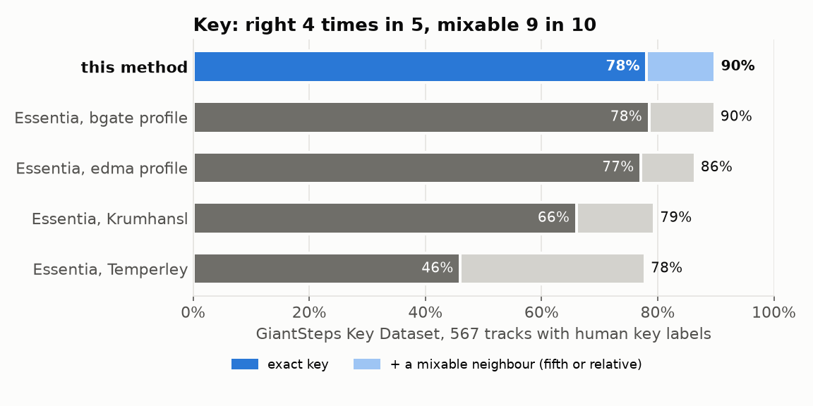
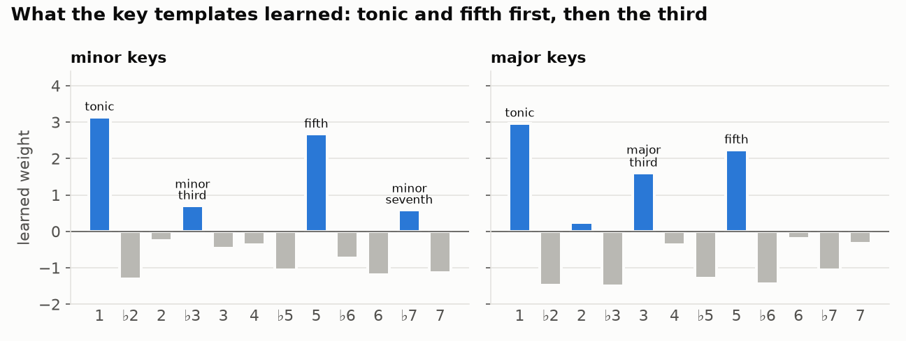
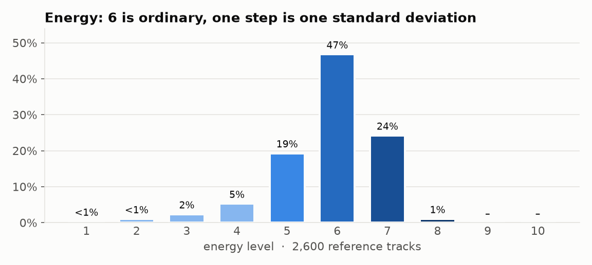
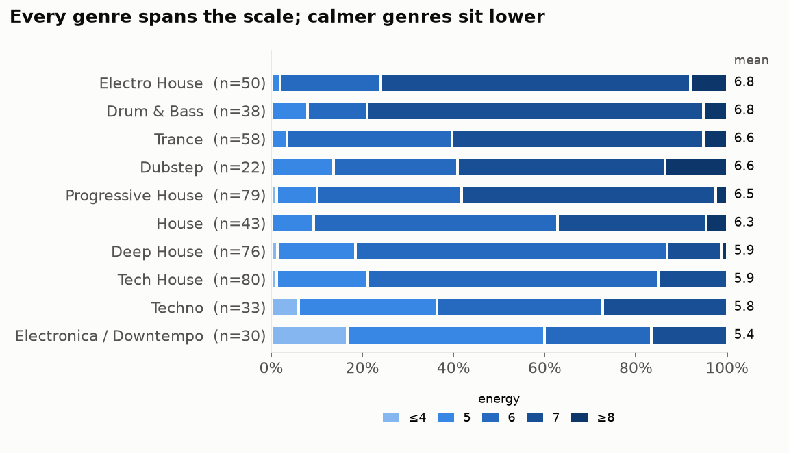

# Key and energy

Every track in a `label` round also gets a **musical key** and an **energy
level**, written into rekordbox next to its colour and rating:

| rekordbox field | example | |
|---|---|---|
| Key | `8A` | A minor, in alphanumeric notation |
| Comments | `8A - Energy 6 /* your tags */` | only the `<key> - Energy <n>` prefix is replaced; the rest is kept |

Neither is learned from you. Both are fixed functions of the audio: the same
file gets the same answer on any machine, every time. That is what keeps them
consistent across a collection and across years.

**At a glance**

| | |
|---|---|
| key, exact | **78%** on 567 human-labelled tracks |
| key, mixable | **90%**: exact, a fifth away, or the relative key |
| energy, stable | **99%** unchanged after re-encoding at 128 kbps, 100% within one step |
| speed | ~40 s per 100-track round on an M1 Pro, cached after that |
| learning from your data | none |

Code: [src/vibecheck/keyenergy.py](../src/vibecheck/keyenergy.py) ·
templates: [src/vibecheck/key_profiles.json](../src/vibecheck/key_profiles.json)

---

## Key



### How it works

1. **Listen for notes.** From 24 ten-second windows spread through the track,
   build a *pitch profile*: how much of each of the twelve notes it contains,
   100 Hz – 5 kHz. Only spectral peaks count, so drums and noise add almost
   nothing. The track's tuning is estimated first, so a record pitched slightly
   off still lands on the right notes.
   *(Harmonic pitch class profile: Fujishima 1999, Gómez 2006.)*
2. **Score all 24 keys.** Rotate the profile so each candidate tonic comes
   first and weigh it against a template for major and one for minor.
   *(Krumhansl & Schmuckler 1990.)*
3. **Lean towards minor.** Dance music is mostly in minor keys, so minor gets
   a fixed head start. *(Key priors: Temperley 2002.)*

The two templates and the minor lean -- 25 numbers in total -- are fitted to
human-annotated electronic music by logistic regression, so the annotated key
scores highest. What they learned is textbook harmony:



Keys are written in **alphanumeric notation**: `8A` is A minor, `8B` its
relative, C major. One number up or down is a fifth, so neighbours on the
wheel mix harmonically.

### How it was measured

- **Trained** on the [Beatport EDM Key Dataset](https://zenodo.org/record/1101082):
  1,486 tracks. Every choice -- features, minor lean, regularisation -- was
  made by cross-validation on this set alone.
- **Tested once** on the [GiantSteps Key Dataset](https://zenodo.org/record/1095691):
  600 two-minute previews across ten genres, no overlap with training, never
  tuned on. 567 have a clear major or minor key; the rest are left out, and
  where annotators gave two keys, either counts.

| GiantSteps, 567 tracks | exact | MIREX weighted | mixable |
|---|--:|--:|--:|
| **this method** | **78.1%** | **83.8%** | **89.9%** |
| · minor-key tracks (447) | 81.2% | | |
| · major-key tracks (120) | 66.7% | | |
| Essentia, bgate profile | 78.5% | 84.1% | 89.8% |
| Essentia, edma profile | 77.1% | 82.7% | 86.4% |
| Essentia, classic Krumhansl | 66.0% | 74.0% | 79.4% |

- **exact**: the right key.
- **MIREX weighted**: the standard research score -- 1 for exact, 0.5 a fifth
  away, 0.3 the relative key, 0.2 the parallel key.
- **mixable**: exact, a fifth away, or the relative key.

So it is on par with the best open-source key detector run the same way on
the same tracks, and above the 74% reported in research for this dataset
(Korzeniowski & Widmer 2017, under a slightly different protocol). On the
training set it scores 58% cross-validated -- that set is deliberately hard,
full of tracks even the annotators disagreed on.

### Where it is weak

- **Little harmony, little key.** Drum tracks and much techno have no strong
  tonal centre; any detector is close to guessing on them.
- **Major is harder than minor** (67% vs 81%): the minor lean pulls borderline
  tracks towards minor. That trade is right more often on dance music.

---

## Energy



### How it works

Three standard audio descriptors (MPEG-7, 2002), each the median over the same
24 windows:

| descriptor | measures |
|---|---|
| loudness | how loud the track is, in dB |
| brightness | spectral centroid: how much of the sound is high-frequency |
| noisiness | spectral flatness: noise and distortion against clean tones |

Each is expressed in standard deviations from a reference set, the three are
added, and the sum is placed on 1–10 so a typical club track is **6** and one
standard deviation is **one step**:

| level | share | meaning |
|---|--:|---|
| 8+ | ~1% | rare, peak intensity |
| 7 | 24% | a lift |
| 6 | 47% | ordinary |
| 5 | 19% | calmer than most |
| 1–4 | ~9% | noticeably calm |

The reference set is about 2,600 tracks: a sample of the reference collection
plus GiantSteps. Only audio statistics come from it -- no ratings, labels or
anyone's judgement of energy. The constants live in `keyenergy.py` and change
only with the method's version.

### What can be claimed

There is no ground truth for energy: it is a perceptual judgement, and no
public set of human energy ratings exists for this use. So the claim is
**consistency**, which can be checked:

1. **Same track, different encoding.** 100 random tracks re-encoded at
   128 kbps: same key on all 100, same energy on 99, the last one step off.
2. **Determinism.** No randomness, no state: the same audio always gives the
   same answer.
3. **Genres fall in a sensible order.**



Not a measure of accuracy -- every genre has calm and intense tracks -- but the
scale runs the way people would expect.

---

## Settings

Under `[rekordbox]` in `.vibecheck/config.toml`:

| setting | default | writes |
|---|---|---|
| `write_tonality` | `true` | the key into rekordbox's Key field |
| `write_comment` | `true` | `<key> - Energy <n>` at the start of the comment |

Commands:

```sh
uv run vibecheck label 100                      # colour, rating, key and energy
uv run vibecheck analyse <playlist> [--dry-run] # key and energy only, for chosen tracks
uv run vibecheck analyse --all --dry-run        # ... or the whole collection
```

Nothing is written to the music files, and nothing changes in rekordbox until a
playlist is imported.

## Reproducing it

```sh
# key templates: fit on one dataset, test once on the other
uv run python scripts/fit_key_profiles.py ~/tmp/beatport-key --test ~/tmp/giantsteps-key

# energy scale: audio statistics of reference tracks
uv run python scripts/fit_energy_scale.py --collection ~/Music/Collection \
    --sample 2000 --extra ~/tmp/giantsteps-key/audio

# consistency checks
uv run python scripts/check_key_energy.py --collection ~/Music/Collection \
    --genres ~/tmp/giantsteps-key

# the charts on this page
uv run --with matplotlib python scripts/plot_key_energy.py ~/tmp/giantsteps-key docs/img/key-energy
```

The datasets are not part of this repository; download them from the sources
below.

## Credits and licences

- **Key templates** (`src/vibecheck/key_profiles.json`): statistics fitted on
  the [Beatport EDM Key Dataset](https://zenodo.org/record/1101082), Ángel
  Faraldo et al., licensed CC BY-SA 4.0.
- **Test set**: the [GiantSteps Key Dataset](https://zenodo.org/record/1095691)
  (Knees et al. 2015), used for measurement only.
- **Comparison**: [Essentia](https://essentia.upf.edu/) key extractor, run
  locally for measurement only; none of its code is used.
- **Methods**: Krumhansl & Schmuckler key-finding (1990); Fujishima pitch
  class profiles (1999); Temperley key priors (2002); Gómez harmonic pitch
  class profiles (2006); MPEG-7 audio descriptors (2002). All implemented here
  from the publications; no third-party key or energy code is used.
- No other software's key or energy output is read, shipped, or used to
  compute any constant here: the key templates come from human annotations,
  the energy scale from audio statistics alone.
