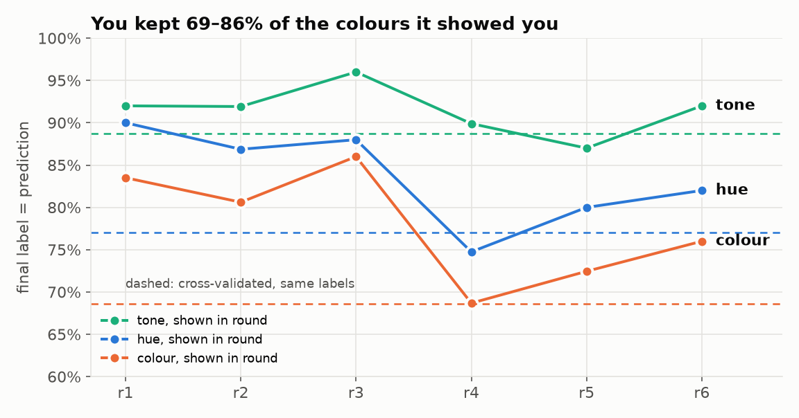
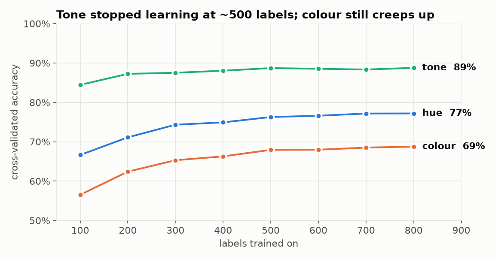
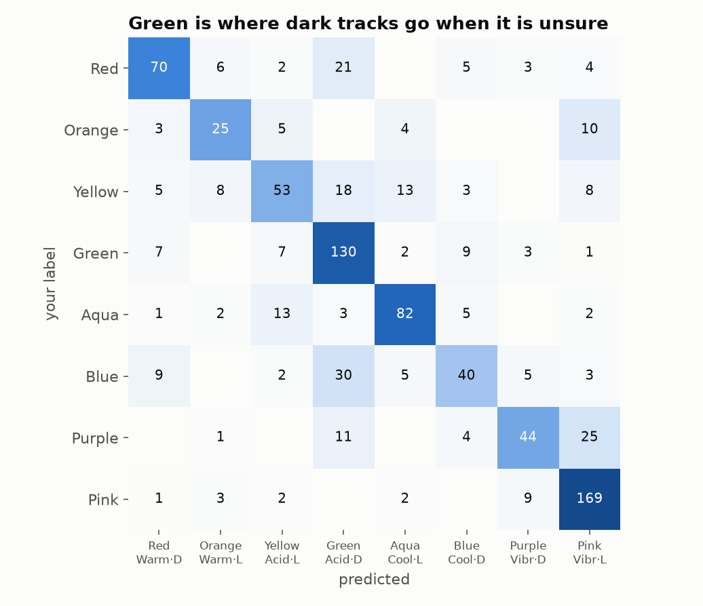
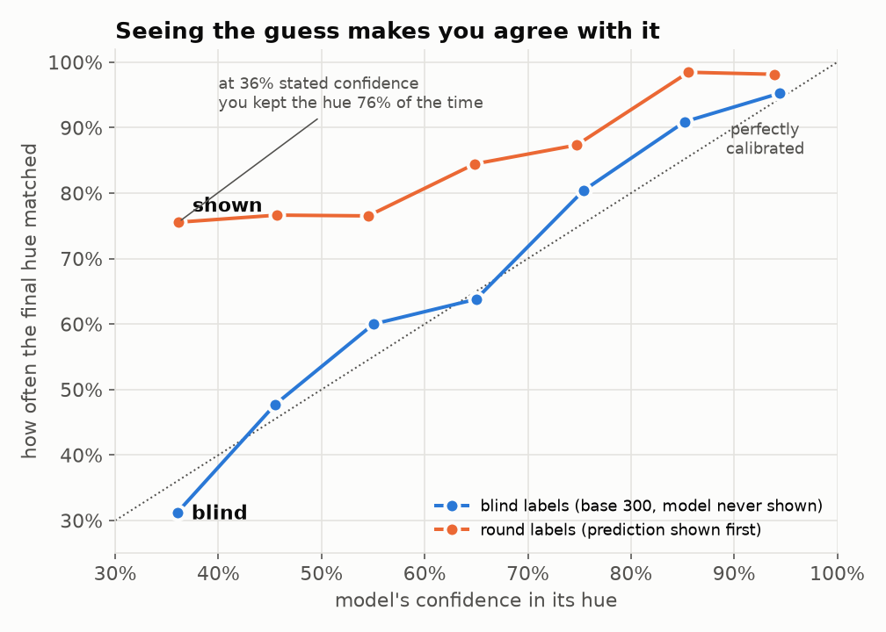
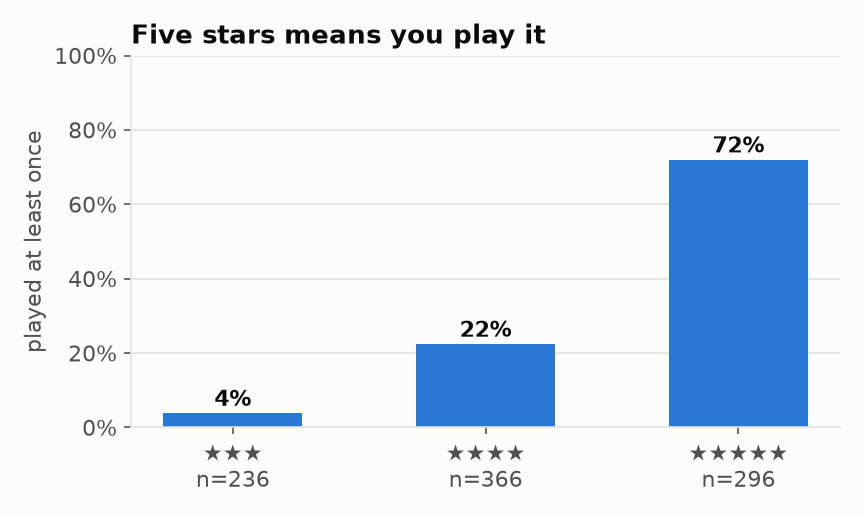
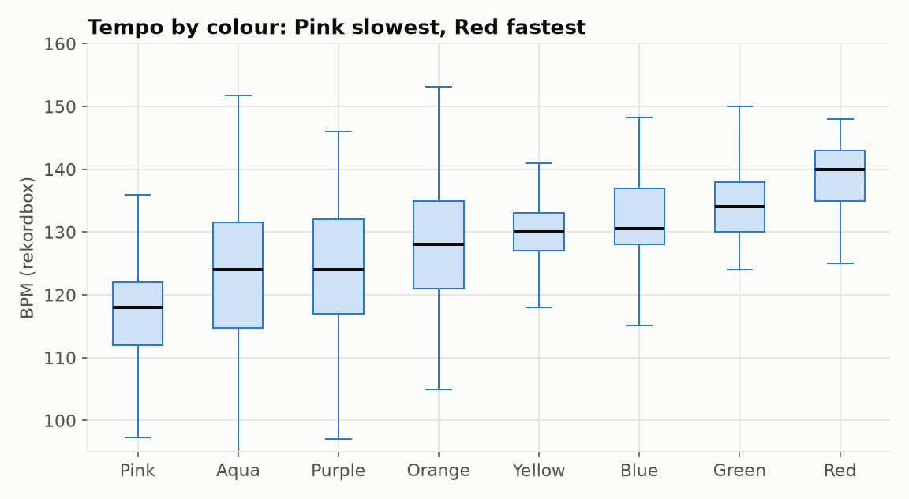
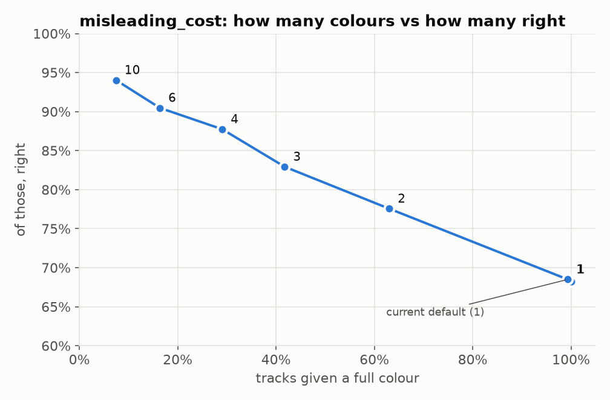

# 1,000 labels in: what the data says

Date: 2026-11-02. Source: the rekordbox export from today, `labels.db` and the
`clapw` embeddings cache, read without writing to either. Snapshot of where
things stand after the first 300 hand labels and seven rounds of 100, with a
month of DJing on top.

Everything is aggregated: no track, artist or playlist names, because this
repo is public.

---

## TL;DR

1. **The new labels are far more learnable than the old ones.** Cross-validated
   colour accuracy is **69%** (hue 77%, tone 89%), against 56% on the retired
   labels with 8× more data. The 4×2 hue/tone grid was the right call:
   combining the two axes beats a direct 8-way colour model.
2. **Part of that is you agreeing with what you were shown.** When the model
   is unsure of a hue (36–55% confident), it gets 31–60% of blind labels right,
   in line with its stated confidence. On the round labels, where you saw the
   guess first, you kept the guess **76% of the time**.
3. **Round 7 looks unreviewed.** All 97 of its colours match what the model
   wrote. Nothing was changed, the three tracks it left blank are still
   blank, and 51 tracks have no rating. If you run `vibecheck label` next, it
   will record all of them as yours.
4. **Your labels don't drift.** After a month of playing them out, only 5 of
   898 reviewed colours and 9 ratings changed (~1%).
5. **More labels now help colour by less than half a point per 100.** Tone
   stopped improving around 500 labels.
6. **Most errors get the hue wrong but the tone right** (179 of 285). Green
   soaks up dark tracks the model is unsure about; Purple leaks into Pink.
7. **Tempo alone gets 36% on colour**, against 21% for always guessing the
   commonest. Adding it to CLAP adds nothing: the embedding already contains it.
8. **Labelling has barely reached the tracks you actually play.** 54 of the
   483 tracks in your Sets playlists are labelled, and 3,015 played tracks
   are not.

---

## The data

| | tracks |
|---|---|
| in the rekordbox export | 14,580 |
| in the collection folder | 14,555 (395 added since the last `scan`) |
| coloured | 995 |
| ↳ base 300, labelled by hand with no model | 300 |
| ↳ rounds 1–6, reviewed | 598 |
| ↳ round 7, not reviewed (see below) | 97 |
| **used for analysis** (base + rounds 1–6) | **898** |
| played at least once | 3,343 |

All figures below use the 898 reviewed labels. Round 7 is left out because its
labels are the model's own output, so counting them would measure the model
against itself.

### What you labelled

| colour | hue · tone | n | share | ★★★ | ★★★★ | ★★★★★ | played |
|---|---|--:|--:|--:|--:|--:|--:|
| Red | Warm · Dark | 111 | 12.4% | 6 | 47 | 58 | 50% |
| Orange | Warm · Light | 47 | 5.2% | 11 | 23 | 13 | 40% |
| Yellow | Acidic · Light | 108 | 12.0% | 11 | 36 | 61 | 56% |
| Green | Acidic · Dark | 159 | 17.7% | 19 | 90 | 50 | 41% |
| Aqua | Cool · Light | 108 | 12.0% | 47 | 31 | 30 | 25% |
| Blue | Cool · Dark | 94 | 10.5% | 16 | 66 | 12 | 18% |
| Purple | Vibrant · Dark | 85 | 9.5% | 30 | 27 | 28 | 19% |
| Pink | Vibrant · Light | 186 | 20.7% | 96 | 46 | 44 | 24% |
| **all** | | **898** | | **236** | **366** | **296** | **34%** |

- **The palette is much more even than before.** The most common colour is
  21% and the rarest 5%. The retired 24-label set had a 412× gap between its
  most and least common labels; this one has 4×. That alone explains a lot of
  the accuracy gain.
- **You use three ratings, not five.** Every reviewed track is ★★★, ★★★★ or
  ★★★★★. The model still treats the rating as one of six values, which makes
  the stars axis more reluctant to speak than it needs to be.
- **Colour and rating aren't independent.** Pink and Aqua lean ★★★, Yellow and
  Red lean ★★★★★, and Blue is almost never ★★★★★.

---

## 1. How the rounds went

Each round predicted 100 tracks before you saw them. Those predictions are
genuinely out-of-sample, so they are the most direct record of what using the
tool was like.

| round | labels known | colour given | colour kept | hue kept | tone kept | stars given | stars kept | decisions left / 3 |
|---|--:|--:|--:|--:|--:|--:|--:|--:|
| r1 | 300 | 97 | 84% | 90% | 92% | 36 | 86% | 0.49 |
| r2 | 400 | 98 | 81% | 87% | 92% | 35 | 60% | 0.58 |
| r3 | 498 | 100 | 86% | 88% | 96% | 40 | 80% | 0.44 |
| r4 | 598 | 99 | 69% | 75% | 90% | 45 | 76% | 0.96 |
| r5 | 697 | 98 | 72% | 80% | 87% | 42 | 64% | 0.84 |
| r6 | 797 | 100 | 76% | 82% | 92% | 40 | 83% | 0.70 |

"Decisions left" counts binary decisions still needed per track at
`misleading_cost = 1`, where labelling from scratch costs 3.00. By that
measure the tool saved 68–85% of the work in every round.

The model kept getting more labels, yet agreement *fell* after round 3.
Rounds 2–4 were also the ones that got corrected late (see §3), so the
likeliest reading is that you reviewed more critically from round 4 on, not
that the model got worse.

The in-app "last measured" figure is computed on the validation bucket, which
is 10–64 tracks per round (about ±6 points). The 10-fold cross-validation
below uses all 898 labels and is the steadier number.

---

## 2. Accuracy, measured properly

10-fold cross-validation repeated 5×, same model as the app
(StandardScaler → LogisticRegression, C = 0.001, clapw 1024-d):

| | colour | hue | tone | stars |
|---|--:|--:|--:|--:|
| always guess the commonest | 20.7% | 30.2% | 50.0% | 40.8% |
| **CLAP, hue × tone grid** | **68.6%** | **77.0%** | **88.7%** | **60.3%** |
| CLAP, direct 8-way colour model | 66.9% | | | |
| CLAP, folds grouped by artist | 68.0% | 76.7% | 88.4% | |
| CLAP, folds grouped by release folder | 65.3% | 73.9% | 87.9% | |
| retired labels, 8.6k tracks (`accuracy.md`) | 56.0% | 66.1% | 80.1% | |

- **Hue × tone beats a direct colour model by 1.7 points.** Independent axes
  are not just easier to read, they also predict better.
- **Same-release leakage costs about 3 points.** When tracks from the same EP
  can't sit on both sides of a split, colour drops to 65%. That is the honest
  figure for music from a release you haven't labelled anything from. The
  app's hash split does not group by release, so its in-app number reads
  slightly high.
- **C = 0.001 is still right.** 0.0003 and 0.01 are both worse, and 0.003 is
  within noise.

### Learning curve

| labels | 100 | 200 | 300 | 400 | 500 | 600 | 700 | 800 |
|---|--:|--:|--:|--:|--:|--:|--:|--:|
| colour | 56.5 | 62.4 | 65.3 | 66.3 | 67.9 | 68.0 | 68.5 | 68.8 |
| hue | 66.6 | 71.1 | 74.3 | 74.9 | 76.3 | 76.6 | 77.2 | 77.2 |
| tone | 84.4 | 87.2 | 87.5 | 88.0 | 88.7 | 88.5 | 88.3 | 88.8 |

Colour is still creeping up at about +0.3 to +0.5 points per 100 labels, and
tone has been flat since 500. More labels are now worth more for *coverage of
your collection* than for model accuracy.

### Where it goes wrong

Of the 285 errors in cross-validation:

| kind of error | n | share |
|---|--:|--:|
| tone right, hue wrong | 179 | 63% |
| hue right, tone wrong | 78 | 27% |
| both wrong | 28 | 10% |

- **Green is the dark default.** It catches 30 of 94 Blue tracks and 21 of 111
  Red ones. Blue gets only 43% recall, the worst of the eight.
- **Purple → Pink** (25 of 85): same hue, wrong tone. Vibrant is easy to
  recognise; dark versus light within it is not.
- **Yellow** spreads across Green, Aqua and Orange. It is the least
  distinctive colour.
- **Pink and Green are the safest** (91% and 82% recall).

---

## 3. You agree with what you're shown

The base 300 were labelled with no model in sight. Every later label was made
after the prediction had already been written into rekordbox. Comparing the
two:

| | n | colour | hue | tone |
|---|--:|--:|--:|--:|
| base 300, blind | 300 | 57.7% | 70.3% | 84.3% |
| rounds 1–6, prediction shown | 598 | 73.6% | 80.3% | 90.1% |

(Same out-of-fold predictions; only the set of tracks scored differs.)

A 16-point gap on colour could just mean your scheme settled down after the
first 300. This chart separates the two explanations:

| model's hue confidence | blind: right | shown: kept |
|---|--:|--:|
| < 40% | 31% (n=16) | 76% (n=45) |
| 40–50% | 48% (n=44) | 77% (n=137) |
| 50–60% | 60% (n=45) | 77% (n=115) |
| 60–70% | 64% (n=58) | 84% (n=103) |
| 70–80% | 80% (n=51) | 87% (n=79) |
| 80–90% | 91% (n=44) | 98% (n=65) |
| ≥ 90% | 95% (n=42) | 98% (n=54) |

**On blind labels the model is calibrated:** when it says 45%, it is right
about 48% of the time. If your scheme had simply become more consistent, the
round curve would sit higher by roughly the same amount at every confidence
level. Instead it is **flat at ~76% across the bottom half**. That is exactly
where the model is guessing, so that is where your agreement comes from the
guess, not the audio. When unsure, you tend to keep what is already there.

This doesn't make the round labels wrong. A colour that is a coin-flip
between two hues is a coin-flip for you too (`ceiling.md`: 45% self-agreement
on the old scheme). But it does mean that:

- **Accuracy measured on round labels overstates the model.** The blind figure
  is about 58% on colour, not 69%.
- **Training on anchored labels pulls the model towards its own earlier
  guesses.** The loop is partly feeding back into itself.

### Confirmation by inaction

67 round tracks have a later user label that differs from their first one. In
**66 of the 67**, that first "user" label was identical to the model's
prediction. In other words, `sync` recorded them as confirmed because they
were unchanged, and you corrected them later. Rounds 2–4 account for nearly
all of them.

So "unchanged since the batch" means "reviewed and agreed" only if you
actually reviewed it. Round 7 is the same situation, only larger:

| round 7 | |
|---|--:|
| colours the model wrote | 97 |
| identical in today's export | 97 |
| tracks it left blank, still blank | 3 |
| ratings: model wrote 46, now present | 46 (51 tracks unrated) |

Every reviewed track in rounds 1–6 has a rating. None of round 7's other 51
tracks do. **If round 7 wasn't reviewed, the next `vibecheck label` will
record all 97 colours as confirmed by you.**

---

## 4. Stability while DJing

Last label recorded in `labels.db` compared with today's export:

| | labels | colour changed | rating changed |
|---|--:|--:|--:|
| base 300 | 300 | 1 | 2 |
| rounds 1–6 | 597 | 4 | 7 |
| **all** | **897** | **5 (0.6%)** | **9 (1.0%)** |

Once a label has been reviewed, playing it out almost never changes your mind.
Whatever noise is in the labels comes from the moment of labelling, not from
later reconsideration.

---

## 5. Stars and play counts

| | ★★★ | ★★★★ | ★★★★★ |
|---|--:|--:|--:|
| tracks | 236 | 366 | 296 |
| played at least once | 4% | 22% | 72% |

The rating is close to "do I play this". That is useful (it is what the
★★★★★ view is for), but it is also why the rating is hard to hear in the
audio. Cross-validated stars accuracy is 60% against a 41% baseline, the
weakest axis relative to its baseline.

The rating axis currently allows six values when you use three. Restricting
it to {3, 4, 5} would make it speak more often at the same risk: knowing the
rating would be worth log₂3 = 1.58 decisions rather than log₂6 = 2.58, and
the threshold would follow from that.

---

## 6. What the metadata knows

Tempo from rekordbox's own analysis, per colour:

| colour | median BPM | BPM IQR |
|---|--:|---|
| Pink | 118 | 112–122 |
| Aqua | 124 | 115–132 |
| Purple | 124 | 117–132 |
| Orange | 128 | 121–135 |
| Yellow | 130 | 127–133 |
| Blue | 130 | 128–137 |
| Green | 134 | 130–138 |
| Red | **140** | 135–143 |

| features | colour | hue | tone |
|---|--:|--:|--:|
| BPM only | 36.0% | 49.6% | 71.7% |
| BPM + duration + year | 38.0% | 51.6% | 69.2% |
| CLAP | 66.9% | 77.0% | 88.7% |
| CLAP + BPM, duration, year | 67.0% | 77.1% | 88.6% |

(Colour here is the direct 8-way model in every row, so the rows compare like
with like.)

- **Your colours partly encode tempo.** Pink is the slow end, Red the fast
  end. Tempo alone gets colour well above the 21% baseline.
- **CLAP already contains it.** Adding tempo gains nothing, so the audio-only
  rule costs nothing here.

### Artist

For the 546 labelled tracks whose artist has other labelled tracks, "same
colour as most of the artist's other tracks" is right **49.8%** of the time.
That is weaker than the audio. Artists span colours more than you might
expect, so the decision to exclude artist lookups costs little.

---

## 7. The dial

Same cross-validated predictions, decision rule re-applied at each
`misleading_cost`:

| misleading_cost | full colour on | of those right | hue on | tone on |
|--:|--:|--:|--:|--:|
| **1 (current)** | **99%** | **68%** | 99% | 100% |
| 2 | 63% | 78% | 79% | 81% |
| 3 | 42% | 83% | 61% | 68% |
| 4 | 29% | 88% | 49% | 60% |
| 6 | 16% | 90% | 35% | 49% |
| 10 | 7% | 94% | 23% | 35% |

At the default, the model names a colour on essentially every track and is
right about 2 times in 3. Combined with §3, that is the setting most exposed
to anchoring: a confident-looking swatch on every track, a third of them
wrong. At `misleading_cost = 2`, a third of tracks show only a hue or a tone
(or nothing), and the colours it does give are right 78% of the time.

---

## 8. The rest of the collection

The current model applied to the 8,378 embedded but unlabelled tracks:

| | Pink | Green | Red | Aqua | Yellow | Purple | Orange | Blue |
|---|--:|--:|--:|--:|--:|--:|--:|--:|
| your labels | 20.7% | 17.7% | 12.4% | 12.0% | 12.0% | 9.5% | 5.2% | 10.5% |
| predicted for the rest | 27.9% | 24.7% | 9.7% | 9.6% | 8.6% | 7.7% | 6.2% | 5.6% |

The prediction over-represents the two safest colours, Pink and Green, and
halves Blue. This is the confusion matrix playing out at collection scale:
when unsure, it falls back on the common colours. Expect the true shares to
look more like your labels.

**Coverage of what you play:**

| | labelled | not labelled |
|---|--:|--:|
| tracks in Sets playlists | 54 | 429 |
| tracks played at least once | 304 | 3,015 |

Rounds pick tracks at random, so they mostly land on music you don't play.
6,000 of the 14,000 tracks went into rekordbox in July 2024, and most of those
are a back catalogue.

---

## What to do with this

1. **Check round 7 before the next `label`.** If it wasn't reviewed, `discard`
   it, or review it and then run `label`. Otherwise 97 unreviewed predictions
   become training data.
2. **Keep a blind slice every round.** Give 10–20 tracks per batch no colour,
   so you label them without seeing a guess. That gives an accuracy figure
   anchoring can't inflate, and training data that doesn't feed the model its
   own guesses. *(Code change; not done.)*
3. **Pick batches from what you play.** Played tracks and Sets tracks first.
   Accuracy gains from more labels are now small, so where the labels land
   matters more than how many there are. *(Code change; not done.)*
4. **Consider `misleading_cost = 2`.** It names fewer colours but gets more of
   them right, and leaves the genuinely uncertain tracks for your ears instead
   of nudging them.
5. **Restrict ratings to {3, 4, 5}.** It matches how you rate, so the stars
   axis would speak on more tracks.
6. **Group the holdout by release.** That would stop the in-app number reading
   about 3 points high.

## Method notes

- **Inputs:** copies of `labels.db` and `cache.db` plus today's
  `~/Documents/rekordbox.xml`, all opened read-only. Paths were matched after
  NFC normalisation.
- **Truth:** the colour and rating in today's export.
- **Provenance:** a track counts as a round track if it appears in the
  `predictions` table, and as base otherwise.
- **Cross-validation:** stratified on colour, 10-fold, repeated with 5 seeds;
  the ± spread across seeds is ≤ 0.8 points everywhere. "Grid" colour is
  argmax hue × argmax tone.
- **Calibration chart:** blind = out-of-fold hue probabilities on the base
  300. Shown = the probabilities stored in `predictions` when each round was
  made, compared with your final labels.
- **Decision-rule sweep:** uses the app's rule,
  `(1 − p)(cost + M) < cost`, with cost = log₂ of the number of values.
