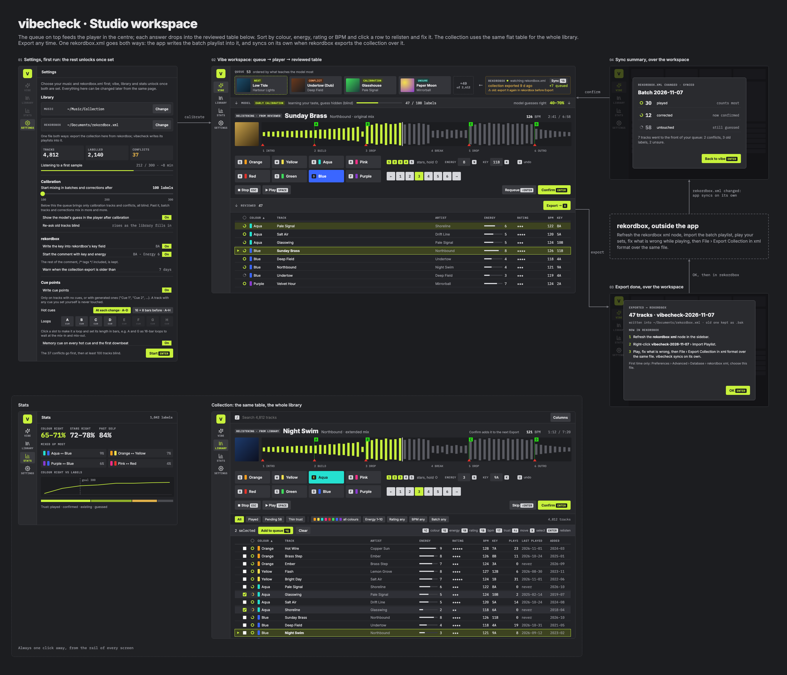

# UI decisions: Studio workspace

The design behind [workspace.html](workspace.html) ([png](workspace.png)),
mirrored from the design canvas
<https://claude.ai/artifact/VGEERe7xK3zbRnQ2Etn7FS>. Each point records what
the user decided and why, so nothing gets lost while building the Godot UI.
[user-flows.md](../user-flows.md) holds the trust and calibration model this
builds on.

Update this file, `workspace.html` and `workspace.png` with every canvas
change. To regenerate the html: take `project/Main.dc.html`, keep the
`<helmet>` contents as `<head>`, and drop `support.js`, the `x-dc` wrapper and
its script.

**Built in Godot** in `app/`, on the core. `app/main.gd` holds the rail, the
dialogs and key routing. Each screen is in `app/ui/`, along with the shared
`player.gd` and `table.gd` (drawn, so 15,000 rows scroll freely), and `ui.gd`
holds the palette and widgets. All of it is built in code: no `.tscn` per
screen and no imported assets. `state.gd` calls the core through the
extension's one JSON call (`ext/src/lib.rs` → `core/src/app.rs`) on worker
threads. Screenshot any screen with
`godot --path app -- --shot=out.png --screen=library --dialog=export`; add
`--music=… --xml=…` (and `VIBECHECK_STATE=<dir>`) to try a copy without
touching the saved settings or the collection's state.

How the app maps onto the core:

- A decision in the player is a `user` label outside any round. What was
  labelled since the last export is the reviewed table and the next export.
  The export is remembered in `.vibecheck/app.json`, with each track's play
  count at the time, so the next sync can count plays.
- Sync is the command line's, plus two rules: a guess the app exported that
  comes back unchanged stays a guess (only the command line's open rounds
  are confirmed that way); and a track labelled after the xml was
  exported is left alone, since the xml can't know about it.
- The model in use is trained on the training slice only, so the accuracy it
  shows is measured on itself (held-back labels, 95% range).
- Queue: calibration tracks spread across the sound of the collection while
  below the threshold; after it, the least sure, mixed with conflicts and old
  labels, asked blind.
- Player sections are the cue model's transitions (mix in, changes, mix out)
  when rekordbox has a beat grid.
- Trust is approximated until schema v5: played = a label and a play count.

## Direction

- Of three directions (A Rack, B Studio, C Paper), **B Studio** was chosen:
  dense, dark, keyboard-first, with a lime accent (`#c8f13c`).
- Remove anything a user would not understand or act on. Removed so far: the
  "Review · batch" header, the "first run" tag, "End calibration early", the
  export warning, and the table hints and sort shortcuts on the export strip.

## Screens and rail

- The rail holds **vibe, library, stats, settings**, with settings directly
  below stats. Each item is an **icon** with a small label underneath:
  sparkles for vibe (it stands for the AI; chosen over headphones,
  a brain, a node graph and a waveform), books for library, a chart for stats,
  a gear for settings. These replace the earlier letters (R/C/S/,). The icons are
  18 px line drawings: grey normally, lime when active.
- **Settings is the setup.** On first run the user fills in Music and
  `rekordbox.xml`; vibe, library and stats stay greyed out until both are
  set. It is the same page afterwards. Keep "Start ENTER" for now.
- Stats and collection are one click away from every screen.

## Vibe workspace: one screen

The main screen is called **Vibe**, after the app's name. It was chosen over
Review, Tag, Train, Check, Label and Listen. "Reviewed" stays as the name of
the table of tracks you have finished.

The screen reads top to bottom as the flow:
queue → model → player → reviewed → table. Lighter strips (`#2a2b2f`) separate
the stages, which sit on the dark background (`#222327`), and ↓ arrows sit at
both ends of each strip. This was the other way round until the user asked to
invert it app-wide: the trust rings read much better on the dark background
(as in their popup), and so does everything else. The same holds on every
screen: content dark; the rail, strips, toolbars and cards lighter; the
waveform and charts darker still (`#1c1d20`); dialogs and popups unchanged.

1. **Queue** (dark). Cards show a 48 px cover, the tag, the title in bold and
   the artist in grey. The queue holds the next 200, rebuilt as the model learns; the
   last card says how many more are queued and how many could be asked in
   all ("+197 of 8,412": tracks listened to and not labelled by you). Tags: next, conflict, calibration, unsure, re-ask, old
   label. The queue is ordered by what teaches the model most.
2. **rekordbox widget**, at the right end of the queue row with a ← pointing
   into the queue, because it is where the queue's tracks come from. It shows:
   - "watching rekordbox.xml";
   - "collection exported X ago";
   - "+N queued";
   - a "Sync ⌥S" button.
   When the export is older than the threshold (default 7 days), the widget
   turns amber and says "old: export it again in rekordbox before Export".
   There is only one timestamp, because the app syncs as soon as rekordbox
   exports.
3. **Model strip** (light), between the queue and the player, because the tracks
   pass through the model. It shows:
   - "early calibration" plus "learning your taste, guess hidden (blind)";
   - progress, e.g. "47 / 100 labels";
   - "model guesses right 40–70%", always shown as a range, so the user sees
     everything from the start.
4. **Player** (dark). Call it "player", never "card". It holds:
   - the **BPM** next to the time at the top right, from rekordbox's grid;
   - the track's **cover in front of the waveform**, as tall as the peaks (a
     gradient in the track's colours when the file has none);
   - the full-track waveform with section labels, click and jump, and the
     **cue points drawn as rekordbox draws them**, so it is clear where they
     will end up: lettered hot cues along the top (green cue, orange loop with
     its length shaded), red memory-cue triangles along the bottom. They are
     what an export would write, from the cue model and the cue settings; a
     track with cues of your own shows those, marked "your cues · kept on
     export";
   - the colour keys in **two rows** (QWER light / ASDF dark), which the user
     likes;
   - two rows exactly the height of the colour keys, so everything lines up
     with them:
     - **upper row, what you say about the track**, level with the light keys:
       stars (1–5, hold ⇧), **Energy** and **Key**, each a value that pops
       out a picker (the user preferred this to − and + buttons): energy 1–10
       in a row (N; ←→ step, a digit picks, 0 is 10), key all 24, minor on
       top and major below, round the wheel (K; ←→ round the wheel, ↑↓
       minor/major); and U undo. A key badge next to a control does the same
       as the control when clicked: the user clicked N and K expecting that. A corrected value
       turns lime. The player shows what an export would write: your
       correction, else the analysis;
     - **lower row, the parts of the track**, level with the dark keys: ←
       then a button per part numbered as on the waveform, the part playing
       lit, →;
   - below the colour keys, the main controls on their own level: Stop (ESC)
     and Play/Pause (SPACE) on the left, Skip and Confirm on the right. They
     moved out of the dark-key row because it no longer fit the window.
   - In the library the hint "Confirm adds it to the next Export" sits on the
     title line, before the time, because the upper row is full.
5. **Reviewed strip** (light). It shows "↓ Reviewed 47" and an **"Export → X"**
   button. The arrow is on the button and points right, because the tracks go
   out of the app. Nothing else is on the strip.
6. **Reviewed table** (dark). One flat table like rekordbox, with no colour
   grouping. Click a header to sort by colour, energy, rating, BPM or trust
   (the ring column's header is a ring; ⌥C ⌥E ⌥R ⌥B ⌥T); click a
   row to relisten in the player and fix it. This is how the user hunts for
   outliers: sort, step through, fix. **Click a trust ring** (here and in the
   library) for a popup that explains it: the four levels (played, set by
   confirmed, existing, guessed) and what each counts for, this track's level
   lit, and what would raise it ("Play it in a set to make it count most").
   The ring is the one new idea to learn (user-flows), so it explains itself
   where it is shown; clicking it doesn't open the track. A lime ▶ at the start of the row marks
   the track in the player; there is no status column ("just reviewed", "in
   the player", "from library" were dropped as noise). The track just saved
   keeps a faint highlight.

### Player buttons: same slot, same keys everywhere

| context | ⇧ENTER | ENTER |
|---|---|---|
| vibe, track from the queue | **Skip track**: next track, no label | **Confirm**: your label, next track |
| vibe, relistening a reviewed row | **Requeue**: back to the queue (the user prefers this short label) | **Confirm**: your label, next row in the list as sorted now; after the last, back to the queue. Sort, then work through the list top to bottom |
| collection | **Skip**: next row, no label | **Confirm**: your label, into the reviewed table and the export, next row |

- ESC stops playback and returns to the start of the track, as Stop; SPACE
  pauses where it is. There is no separate "back" or "close".
- The label changes with the context, but the position and the key never do.
- **Keyboard layouts.** The colour grid and the number row are matched by
  position, so they stay a grid on any layout, and their badges show what the
  keyboard in use prints there (on Neo 2: X V L C / U I A E). Every other
  shortcut is matched by the letter it types (N, K, U, X, ⌥S, …). Where a
  letter lands on a colour position, the colour wins: on Neo 2 that is U (the
  Red position) and X (Orange), so undo is also ⌘Z, the same on every layout.
  The user types on Neo 2.
- ENTER is **Confirm**. Before it was "Save" (the user found it confusing:
  it sounds like storing a file, not like the values becoming yours) and
  before that "Next" (undersold it). "Confirm" was first rejected as sounding
  like accepting the model's guess, but most values are pre-filled now
  (guesses, list rows), and on a blind track you confirm your own picks; the
  blind setting, not the word, guards against anchoring. Considered too:
  Done, Label, Keep, Approve/Accept, Set.
- Trust level names follow: **confirmed** (was "set by hand") and
  **guessed** (was "untouched", unclear). The sync summary still says
  "untouched", since there it is what happened in rekordbox ("still
  guessed").

### Drag in from rekordbox

- Select tracks in rekordbox and drag them onto the vibe screen. Where they
  land decides what happens:
  - **on the reviewed strip or table**: they join the list and the **next
    Export** as they are, every row alike (the user: "users will not care
    about this distinction; the trust ring says whether it was confirmed").
    A track with no colour gets the model's guess for colour and stars, saved
    as its label (guessed); one with a rekordbox colour keeps it (existing,
    or played). The export remembers those rekordbox colours: changed in
    rekordbox by the next sync, it becomes your label; left alone, it stays
    as it was. The first opens in the player ("from rekordbox"); Confirm moves
    down the list, Skip to the next dropped row. Kept across restarts in the
    collection's `.vibecheck/app.json` until exported. (Before, dropped rows
    with a colour were dimmed and held back until confirmed; dropped.) No
    guesses while calibrating or with the guess turned off; a track the model
    hasn't listened to is listened to first, a few seconds each;
  - **anywhere else**: to the **front of the queue**, in the order dragged,
    tagged "from rekordbox", the first straight into the player, also as they
    are, not blind. They stay at the front when the queue is rebuilt, until
    confirmed or skipped; "Add to queue" from the library works the same way,
    after the track playing.
- rekordbox drags the files themselves (it copies them when dropped on a
  folder), so the app gets their paths and matches them to the library,
  compared normalised since macOS may hand names over decomposed. The drop
  carries no position, so the app reads where the mouse let go.
- Files outside the collection are listed in a short notice, not added.

## Calibration

- There is no button to end or skip calibration. It is just the queue's early
  phase, and the model strip shows where you are.
- In settings, a **threshold slider (100–300, default 100)** sets when batch
  tracks and corrections start mixing into the queue. Below it the queue holds
  only calibration tracks and conflicts, all blind.
- "Skip track" means only "skip this one track". Users read it that way, so it
  must never mean "skip calibration".

## rekordbox: export and sync

- **One file both ways**, as in the CLI: `~/Documents/rekordbox.xml`.
  rekordbox exports the collection over it, and vibecheck writes its playlists
  into it (keeping the old one as `.bak`). The user then just refreshes in
  rekordbox.
- **Export** can happen at any time and opens the **Export done** popup, which
  dims the workspace and says:
  - "47 tracks · vibecheck-2026-11-07", written into the xml;
  - **Now in rekordbox:**
    1. refresh the rekordbox xml node;
    2. right-click the playlist › Import Playlist;
    3. play, fix, then File › Export Collection in xml format over the same
       file, and vibecheck syncs on its own;
  - **First time only:** Preferences › Advanced › Database › rekordbox xml,
    then choose the file;
  - OK, with ENTER.
- **Sync** is automatic. The app watches the xml, and when rekordbox exports,
  the **Sync summary** popup dims the workspace and shows: played / corrected /
  untouched, plus how many tracks went to the front of the queue. "Back to
  vibe ENTER" confirms. "Sync ⌥S" in the widget is the manual fallback.
- Importing applies every field in the xml, so the export has to be recent.
  That is why the widget warns when it is old.
- **Canvas layout:** export goes out at the bottom (the export strip → the
  Export done popup, bottom right), and sync comes in at the top (rekordbox →
  the Sync summary, top right → confirm → the queue).

## Collection

- The player is docked **on top** and is the **same component as in vibe**,
  so the user recognises it and it can be reused.
- Below it: filter chips, then a selection bar ("N selected · Add to
  queue ⌥Q"), then the **same flat table** with extra columns (plays, last
  played, added).
- Stepping through the collection with Confirm puts each track into the **same
  reviewed table** as vibe, so it goes out with the next Export.

## Settings contents

- Library: the Music path and the `rekordbox.xml` path, with the note that the
  one file is used both ways.
- Track, labelled and conflict counts, and the progress of listening to a first
  sample.
- The calibration threshold, 100–300.
- Show the model's guess in the player after calibration (On).
- Re-ask old tracks blind (rises as the library fills in).
- **rekordbox**
  - Write the key into rekordbox's key field ("8A"): `[rekordbox] write_tonality`.
  - Start the comment with key and energy ("8A - Energy 6"); the rest of the
    comment, /* tags */ included, is kept: `[rekordbox] write_comment`.
  - Warn when the collection export is older than 7 days. This one is new and
    not in the config yet.
- **Cue points**
  - Write cue points (`[cues] write`). They go only on tracks with no cues or
    with generated ones; a track with any cue you set yourself is never touched.
  - Hot cues (`[cues] lead`), two presets:
    - "At each change · A–D" = `[0]`;
    - "16 + 8 bars before · A–H" = `[16, 8]`.
  - Loops (`[cues] loops`): slots A–H, each a cue or a loop. Click a slot to
    set its length in bars. Slots the chosen preset doesn't use are dimmed.
  - Memory cue on every hot cue and the first downbeat (`[cues] memory`).
- Key and energy you correct in the player are saved with Confirm in `labels.db`
  (`key_energy`, schema v5, the first the Python prototype can't open) and
  win over the analysis in the library and in every export.
- Not in settings yet:
  - `misleading_cost` and `rating_misleading_cost`. These could become
    "guess often ↔ only when sure" sliders.
  - `cues.retrain_after`.
  - `[audio]` and `[model]` never go in settings: they are pinned and part of
    the cache key.

## Open

- Should the table rows show cover art too? (The player does.)
- Should the Export button warn or block while the collection export is old?
- Should settings later drop "Start" and move the counts to stats?
- Should the collection player fold to a slim bar when no track is open?
- Does a skipped track go back into the queue or get dropped?
