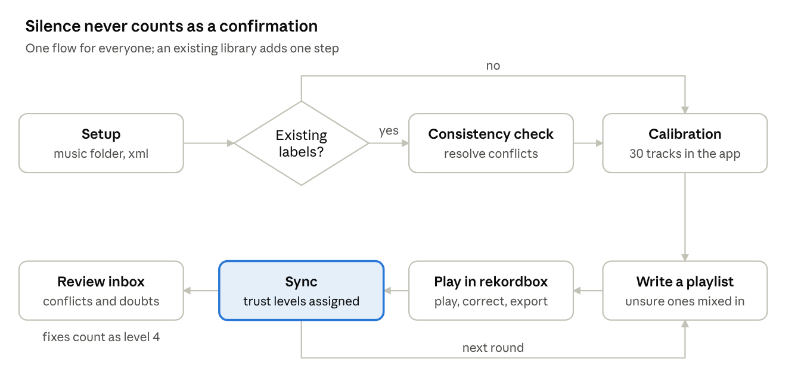

# User flows

*2026-11-06. Proposal.*

Labels should count by what the user actually did, not by silence. Today a
track left unchanged after a round counts as confirmed. That works for someone
who reviews every track carefully, but not for a new user who skims. This doc
proposes trust levels plus one guided flow, so the app works well for both.

## Direction

In general, confirming and correcting should happen in the app, right after
the model suggests, while the tracks are fresh. rekordbox then only receives
finished results: labels the user has already seen and decided. Review has to
be fast: listening, jumping around and confirming should never make the user
stop and think.

This changes the flow below. The rekordbox round trip is no longer where
review happens; it becomes the output, plus a later source of signal
(corrections made while playing, play counts). Sections further down still
describe the round-trip version and will be reworked around this direction;
the research section near the end supports it.

Labels set in the app are still provisional. Playing a track in a set is the
final check: the label it has after that, kept or edited, counts highest (see
trust levels).

## The problem

The current loop treats "unchanged" as "confirmed". A user who doesn't review
a playlist closely confirms the model's own guesses. The model then trains on
them and repeats them, and each round drifts further from what the user really
thinks.

This is what happened at the very start: labels were inconsistent, results
were poor, and the only way out was to start over. It shows up in both of
today's use cases:

- **Fresh start:** generate a playlist, review it in rekordbox, sync. Every
  track not corrected becomes a label at full weight.
- **Established library:** the same loop, plus an initial sync of the colours
  and ratings already in rekordbox. Those were often set over years, with no
  consistent rule, and they all count at full weight from day one.

Neither case can tell "I listened and agree" from "I didn't look".

## Trust levels

Every label gets a level from what the user did with it. Training weights each
label by its level. The user never has to choose a mode or understand the
rule; they only see a small indicator per track.

| level | what the user did | training weight | notes |
|---|---|---|---|
| 4: played | played it after we wrote the label (its play count went up), then kept it or edited it | 1.0 | the strongest signal: tested in a real set; the label left after playing is the final one, edited or not |
| 3: confirmed (was "set by hand") | labelled it in the app, or changed our colour or rating in rekordbox, and not played since | about 0.7 | a considered first impression; moves to 4 once played. Editing its cues counts here too |
| 2: existing label | it was there before vibecheck | about 0.3 until checked | a library's history can be wildly inconsistent; a track that has been played starts at 4 instead |
| 1: guessed (was "untouched") | we wrote it and nothing happened since | about 0.2 | usually more or less right, just not worth playing or correcting; kept small so the model doesn't learn its own guesses back |

The weights are a starting point to tune, not measured values.

Age alone doesn't lower trust: an old label can be perfectly right. What
matters is age together with disagreement. An old label the current model
strongly disagrees with goes to the review queue, since the user's taste may
have changed or it was a mistake. An old label the model agrees with is left
alone.

One play is enough. Pre-listening in cue mode doesn't add to the play count,
so a play means the track was chosen over the alternatives, mixed in and
played out. Plays only show up after rekordbox has the play count. Plays on
CDJs count once rekordbox imports the USB history.

## The flow

Fresh start and established library become one flow; the established library
only adds the consistency check.

1. **Setup.** Choose the music folder and the rekordbox xml. Scanning takes
   seconds. Vectors are computed in the background, starting with a random
   sample so calibration can begin within about 30 minutes.
2. **Consistency check** (only if labels exist). Import them all at level 2.
   Find near-identical tracks with different labels, and labels the model
   rejects. Show them as "which is right?" cards; every answer becomes level 3.
   Labels that pass the check stay at level 2: the model that agrees with them
   was trained on them, so passing is not the same as the user confirming.
3. **Calibration.** At least 100 tracks, with 300 as the goal, chosen to cover
   the sound of the collection and labelled blind in the app. Skipping is
   allowed. This gives the model a clean base before the first round, which is
   what the fresh start lacked. Details below.
4. **Rounds.** Today's loop: write a playlist, play and correct in rekordbox,
   export, sync. Sync assigns levels instead of confirming. Untouched tracks
   stay pending, and the round stays open until they earn trust. "Confirm all
   untouched" is a deliberate button with a warning, not the default.
5. **Review inbox.** Fills up from every sync: conflicts, old labels the model
   now disagrees with, and the tracks it is least sure about. These teach the
   model the most per minute spent.

### Calibration: 100 to 300 labels

A fresh start has no labels, and the first labels decide how good the first
suggestions are. The learning curve on the author's collection
(cross-validated accuracy against the number of labels trained on) shows
colour still improving well past 100:

| labels | 100 | 200 | 300 | 500 | 800 |
|---|---:|---:|---:|---:|---:|
| colour | 56% | 62% | 65% | 68% | 69% |
| hue | 67% | 71% | 74% | 76% | 77% |
| tone | 84% | 87% | 88% | 89% | 89% |

So calibration suggests at least 100 labels and sets 300 as the goal; past
about 500, more labels change little.

- **Blind.** The card shows no suggestion, so the labels are the user's own.
- **Time.** At about 15 s per track, clicking through a few parts of each,
  100 tracks take roughly 25 minutes and 300 about an hour and a quarter.
  Calibration pauses and resumes across sessions.
- **Skipping is allowed.** A user who skips corrects more in the first rounds
  instead. Suggestions stay off until 100 labels by hand either way, so
  skipping never brings back the anchoring problem.
- **Only decisions count.** With a library, answers to the consistency check's
  cards count toward the 100; labels that merely pass the check don't.

The screen always says what the user is doing, why, and what skipping costs:

- **What:** "Label tracks so vibecheck learns how you hear colour and rating:
  listen around the track, pick a colour and stars."
- **Why:** "It learns only from you. The more you label now, the fewer
  corrections later."
- **Progress:** labels done with 100 and 300 marked, time left, and the
  accuracy measured on the user's own labels, shown from the first label as a
  range that narrows as labels come in, e.g. "40–70%, 30 labels".
- **Skip:** a button that states the cost with the live number, e.g. "The
  model is right about half the time now. Skipping means more corrections in
  your first rounds. You can come back to this any time."

## What the UI needs

Seven screens, plus one indicator that shows up everywhere:

| screen | what it does | why it matters |
|---|---|---|
| setup | choose the music folder and the rekordbox xml; shows vectors being computed in the background | the first two minutes decide whether people stay |
| card review | one track at a time: the whole track on a waveform, click or use keys to jump between the intro, the drop and other parts, a few seconds each; pick colour and stars on a grid, next; fully keyboard driven | used for calibration, conflicts and the review queue; the most eye-catching part to animate |
| sync summary | after each sync: e.g. "12 corrected · 30 played · 58 untouched" | makes the trust rule visible without explaining it |
| review inbox | conflicts, old labels the model now disagrees with, tracks it is least sure about; a count badge | gives a reason to come back between rounds |
| collection | every track with its labels and a trust ring coloured by level | shows progress and where trust is thin |
| outlier pass | the reviewed batch sorted or grouped by colour or rating, skimmed a few times; tracks the model thinks stand out in their group are marked | catches what the first pass missed, without stopping to think |
| stats | accuracy per colour and for stars, which colours get mixed up, accuracy against the number of labels, agreement with your past self, tracks per trust level | full transparency: what the model has learnt and where it is weak |

The trust ring is the one new idea the user has to learn, so it appears the
same way on every screen.

Settings keep today's workflow for experienced users: "treat untouched tracks
as confirmed", off by default.

## What has to change in the core

All of this belongs in the Rust core, so the command line and the app behave
the same.

| change | where | size |
|---|---|---|
| store each label's level and where it came from; snapshot play count and cues per track when a round is written | `store.rs`, a schema v5 migration | small |
| read `PlayCount` from the rekordbox xml | `rekordbox.rs` | small |
| sync assigns levels instead of confirming; untouched tracks stay pending and the round stays open | `commands.rs` | medium |
| weighted training: each label's weight in the classifier's loss | `predict.rs` | small |
| consistency check: near-identical vectors with different labels, and existing labels the model rejects under cross-validation | new | medium |
| selection: mix in the tracks the model is least sure about, not only a random pick | `commands.rs` | small |
| calibration pick: 100 to 300 tracks spread across the sound of the collection | new, uses the vectors | small |
| vectors computed in the background, most useful tracks first | `embed.rs` | medium |

The calibration pick needs vectors, and a whole library takes about 20 hours
at 5 s per track. So the app starts with a random sample of a few hundred
tracks (about 30 minutes) and picks the first calibration tracks from those.
The sample keeps growing in the background while the user labels, so later
picks have more to choose from.

The Python prototype is frozen at schema v4: it stays as it is, and work
continues in the Rust core and the Godot app. From v5 on, a collection uses
the Rust version.

Migrating an existing collection to v5: every label the user has set starts
at level 3, since each was listened to or relabelled; tracks that have been
played move up to 4. Rounds that are still open and unreviewed stay pending.

## What similar products and research show

The products closest to vibecheck all make review an explicit, cheap action,
and none of them treat silence as approval.

| product | how it learns from the user | lesson for vibecheck |
|---|---|---|
| [Copilot Money](https://help.copilot.money/en/articles/8182433-copilot-intelligence-for-spending) (budgeting) | new transactions land in a "To Review" inbox; only reviewed ones teach each user's own model; suggestions start after 30 reviewed ([quick start](https://help.copilot.money/en/articles/11157550-quick-start-guide)) | an explicit review inbox, inbox zero as the goal, a calibration threshold before suggestions |
| [Prodigy](https://explosion.ai/blog/prodigy-annotation-tool-active-learning) (labelling training data) | one decision at a time, accept or reject with one key or a swipe; the model picks what it is least sure about ([text classification](https://future.prodi.gy/features/text-classification)) | the card review screen: one track, one key per answer, uncertain tracks first |
| [Apple Photos, People](https://support.apple.com/en-la/guide/photos/phtad9d981ab/9.0/mac/14.0) | "Is this X?", Yes or No; users complain that batch confirms mix lookalikes and that there was no undo ([discussion](https://discussions.apple.com/thread/255900660), [blog](https://twocentsonapple.blogspot.com/2018/01/on-photos-face-tagging-and.html)) | no casual "confirm all"; every decision can be undone |
| [Cyanite](https://cyanite.ai/music-tagging/) (music tagging) | tags genre, mood and energy from audio, similarity search for DJs; no sign of learning from an individual user | per-user learning is what sets vibecheck apart |

One research result matters directly:

- **Suggestions get over-accepted.** In
  [Bias in the Loop](https://hdsr.mitpress.mit.edu/pub/nrcn4h7d) (Beck et al.,
  2,784 participants), people who favour automation accepted more wrong
  suggestions, and making corrections harder to enter lowered the correction
  rate ([arXiv](https://arxiv.org/html/2509.08514v1)). In a
  [crowdworker study](https://web3.arxiv.org/pdf/2507.15821), AI suggestions
  shifted the labels people gave without making them faster. This is the
  problem vibecheck had at the start: showing the model's guess anchors even
  careful users.

What this suggests for the flow:

1. **Ask blind first.** Calibration and conflict cards show no suggestion.
   Suggestions start only after 100 labels by hand, also when calibration was
   skipped.
2. **Correcting costs one key.** One key per colour on the card, so changing a
   label is as fast as accepting it.
3. **Re-ask old tracks now and then.** Re-ask a track labelled months ago,
   without showing the old answer. It measures how consistent the user is
   with themselves and catches taste drift, e.g. "you agree with your past
   self 84% of the time". None at first, while the user is getting the
   library into shape; rising to about 1 in 20 cards once most of the
   collection is at level 3 or higher.
4. **An outlier pass after review.** Sort or group the batch by colour or
   rating and skim it a few times; the app marks tracks that stand out in
   their group. This is how review already works in rekordbox, and it keeps
   the flow fast.
5. **Show examples.** Next to each colour, 2–3 of the user's most trusted
   tracks with that colour as a reference. Standard practice in labelling
   guidelines, not from the sources above.
6. **Undo everything**, and no bulk confirm without friction.
7. **Batches still go to rekordbox as a playlist,** which makes importing each
   processed batch easy. For corrections made later in rekordbox, removing a
   track from it could also mean "reviewed", but that is a secondary path.

## Open questions

- [ ] Revisit with data from real libraries: should labels that pass the consistency check move up to level 3, or should level 2's weight rise to about 0.4–0.5? For now they stay at level 2, weight about 0.3.
